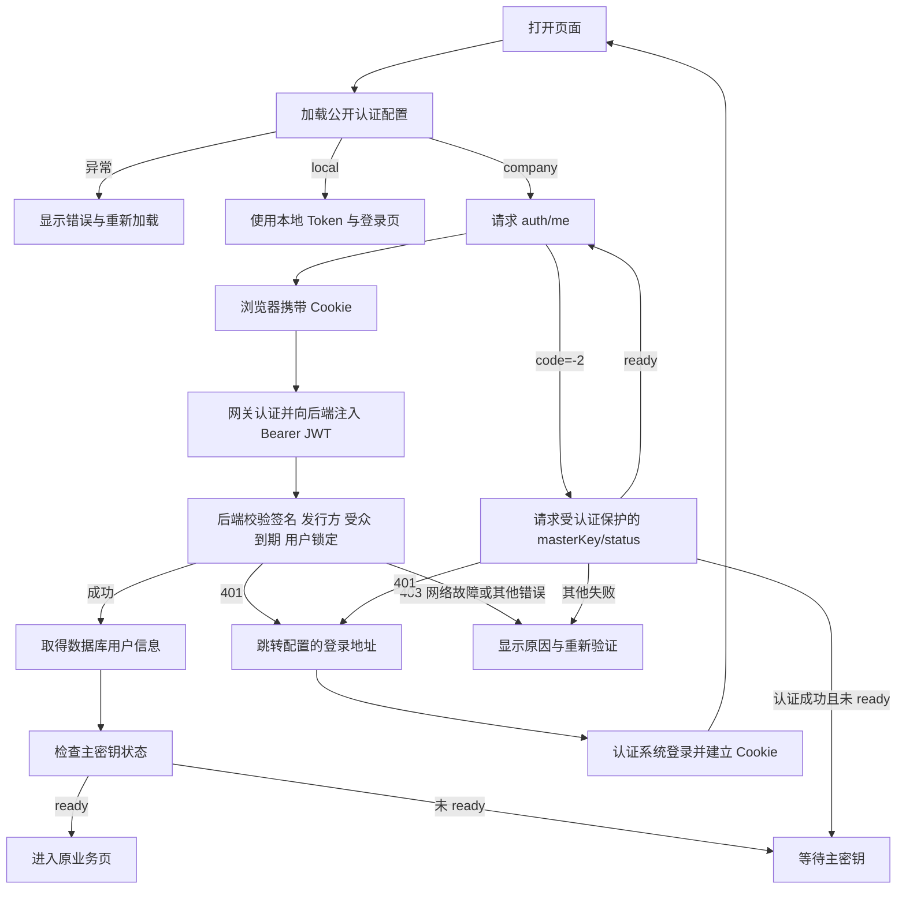

# 登录认证与外部认证接入

更新：2026-10-21

## 1. 本次实现与参考

只读参考 `micro-frontend-main/src/server/index.ts` 和 `devops-frontend/src/server/index.ts`：两个项目收到 HTTP 401 或业务 code=401 时，均跳转同域 `/tologin.do?url=当前页面`；localhost 使用了写死的测试认证域名

Env Vault 保留现有平台的跳转约定，但不复制这些写死的测试域名。认证方式、登录地址、返回参数名、展示名称和可选退出地址统一由 `src/config/auth.ts` 管理

此次修改涉及 Env Vault 前端、公开配置和部署挂载，后端认证接口与 SDK 协议不变，没有修改基座或发布模块

## 2. 两种认证方式

| 模式 | 浏览器凭据 | 身份来源 | 失效处理 |
| --- | --- | --- | --- |
| `local` | 本地登录获得并保存的 JWT | `/pub/auth/login` 签发，后端本地公钥验签 | 回到 Env Vault 本地登录页 |
| `company` | 浏览器自动携带同域 Cookie | 网关校验 Cookie，向后端注入 `Authorization: Bearer <JWT>` | 跳转配置的统一认证入口 |

`company` 是“外部认证网关 + JWT”的模式名称，不绑定某家公司。认证模式与嵌入方式独立，直接打开 `/envvault/` 也能使用外部认证。iframe 只影响布局、主题、导航和跳转父窗口，不是已登录的依据

公司模式忽略浏览器曾经保存的本地 Token，并在请求拦截器中移除浏览器端 Authorization。网关注入的 Header 位于网关到后端这一段，浏览器无法直接读取；前端通过 `/auth/me` 核实身份，不解析 Cookie、不持有验签私钥或公司 JWT

## 3. 配置与优先级

加载顺序：运行时 `auth-config.json` 中显式填写的字段 > 构建时 `VITE_*` 默认值 > 代码默认值

```json
{
  "mode": "company",
  "loginUrl": "/tologin.do",
  "returnUrlParam": "url",
  "loginLabel": "公司认证",
  "logoutUrl": "",
  "logoutReturnUrlParam": "url"
}
```

| 字段 | 说明 |
| --- | --- |
| `mode` | `company` 或 `local`，页面启动前确定 |
| `loginUrl` | 登录入口，同域路径或完整 HTTP(S) URL，支持保留已有查询参数 |
| `returnUrlParam` | 登录完成后的完整返回地址参数名，默认 `url`；可改为 `rd`、`redirect`、`service` 等；空字符串表示不追加参数 |
| `loginLabel` | 登录页标题，例如“公司认证”或“统一身份认证” |
| `logoutUrl` | 可选统一退出入口，空字符串表示仅退出当前 Env Vault 应用 |
| `logoutReturnUrlParam` | 统一退出完成后的返回参数名，默认 `url`；空字符串表示不追加参数 |

所有字段均为字符串，未填写时沿用默认值。未知字段、错误类型、非法模式、空登录入口、非 HTTP(S) 入口和指向本应用登录页的认证入口都会被拒绝。配置文件是公开资源，只允许存放公开入口，禁止填写 Cookie、Token、客户端密钥、JWT 私钥或公钥

前端请求 `${BASE_URL}auth-config.json`，生产路径为 `/envvault/auth-config.json`。镜像内的 `public/auth-config.json` 为 `{}`，不会覆盖构建默认值；部署文件挂载的 ConfigMap 覆盖它

- 生产构建默认 `company`，普通本地开发默认 `local`
- 构建默认值：`VITE_AUTH_MODE`、`VITE_COMPANY_LOGIN_URL`、`VITE_COMPANY_RETURN_URL_PARAM`
- 运行时文件不存在（404）才沿用构建配置，兼容未挂载该文件的旧部署
- 网络错误、超时、非 404 错误或 JSON 不合法时停止启动，显示“重新加载”，不会静默回退本地认证
- 加载超时为 10 秒，请求与 Nginx 响应均禁止缓存；加载完成前不创建认证 Store 或执行路由守卫
- 网关需要允许 HTML、静态资源和公开配置正常返回；API 的未认证请求应返回 401，不能用 200 登录 HTML 冒充 API 响应

### 切换到其他入口的例子

只改变网关登录入口和返回参数名：

```json
{
  "mode": "company",
  "loginUrl": "https://sso.example.com/login?client=vault",
  "returnUrlParam": "redirect",
  "loginLabel": "统一身份认证"
}
```

使用已经接好回调的 OAuth2 网关入口：

```json
{
  "mode": "company",
  "loginUrl": "/oauth2/start",
  "returnUrlParam": "rd",
  "loginLabel": "单点登录"
}
```

这不是前端直接实现 OIDC。`loginUrl` 必须是能完成认证、建立网关 Cookie 并返回业务页的入口；OIDC 的 state、nonce、PKCE、授权码兑换等仍由认证网关或独立适配层负责。不能只把该配置改成 IdP 的授权端点就认为完成了接入

## 4. 正常与异常链路



主密钥就绪中间件先于 JWT 中间件执行，`/auth/me` 的 `code=-2` 不能证明已登录。必须用仍受 JWT 与用户锁定检查保护的 `/masterKey/status` 确认身份后，才能展示等待页。主密钥恢复后重新读取 `/auth/me`，再回到原页面

初次身份查询合并并发调用，并展示加载状态；身份未确认前不渲染受保护页面。后台业务请求仍逐次经过后端认证，前端的会话标记不是长期授权凭证

| 返回情况 | 前端行为 |
| --- | --- |
| HTTP 401，或业务 code=401/1401 | 公司模式跳转统一认证，本地模式回本地登录 |
| HTTP 403、用户被锁定 | 显示错误，允许重新验证，不触发登录循环 |
| 网络错误、502/503/504、协议异常 | 显示错误与重试，不当作登录过期 |
| `code=-2` | 进入经过身份核验的主密钥等待流程 |
| JWT 合法但数据库不存在用户 | 展示后端 `user not found`，不自动创建用户、不循环登录 |

## 5. 跳转、嵌入与退出

登录返回地址使用当前页面完整地址，保留路径、查询参数和 hash；从本地登录中间页发起时，使用原始业务地址。返回地址只允许本站，统一登录入口本身可指向配置的外部域名

同源基座嵌入时跳转父窗口，返回父页面路由，例如 `/app-envvault/app/secrets`，避免认证页嵌套在 iframe 内。当前基座识别仍沿用同源 `/app-envvault` 约定；跨域嵌入或其他基座的桥接协议另行适配

自动跳转前在 sessionStorage 记录时间。30 秒内再次未认证时暂停自动跳转，显示“登录后仍无法确认身份”，可手动点击“前往登录”。认证成功后清除该标记，避免配置错误时无限刷新；浏览器禁用会话存储时不阻断登录，但无法跨刷新防止该类循环

退出时先清理 Env Vault 的认证、用户、权限和主密钥状态缓存。如果配置 `logoutUrl`，随后跳转统一退出入口；未配置时仅退出应用，不宣称注销平台 Cookie，重新验证仍可能自动登录。主页面和主密钥等待页使用同一退出配置

公司模式不使用本地 JWT 的两小时期限，不在前端另设两小时倒计时。真实有效期取决于网关会话、公司 JWT 的 exp 和平台的刷新策略；即使平台 Cookie 有效八小时，当前 JWT 若已过期，后端仍会返回 401

## 6. Kubernetes 与发布

前端独立清单 `deploy/k8s/env-vault-web-deployment.yaml` 和后端合并清单 `deploy/k8s/env-vault-statefulset.yaml` 已加入同名 `env-vault-web-auth` ConfigMap 与文件挂载，两份清单选择一种维护同一资源，避免相互覆盖

```yaml
volumeMounts:
  - name: auth-config
    mountPath: /usr/share/nginx/html/auth-config.json
    subPath: auth-config.json
    readOnly: true
volumes:
  - name: auth-config
    configMap:
      name: env-vault-web-auth
```

首次部署本功能需要重建前端镜像，因为旧镜像没有读取运行时配置的代码。后续只调整登录入口：修改 ConfigMap、apply、滚动重启 Web，无需重建镜像

```bash
kubectl apply -f deploy/k8s/env-vault-web-deployment.yaml
kubectl -n env-vault rollout restart deployment/env-vault-web
kubectl -n env-vault rollout status deployment/env-vault-web
```

`subPath` 挂载不会实时更新，不能省略重启；已经打开的标签页需要刷新重新加载配置。若使用其他部署模板，也需要同步 ConfigMap 与挂载，不能仅修改容器环境变量期望改变已有静态资源

Ingress 保留既有域名和 `/envvault` 路径改写，Web Nginx 原样透传网关注入的 Authorization。API 优先访问 Ready 后端，502/503/504 回退 bootstrap 的现有高可用链路不变

## 7. 已验证与待确认

本地验证结果：22 个测试文件、121 项测试通过，`pnpm build` 包含类型检查与生产构建并通过；后端现有认证定向测试通过；两个部署清单完成 YAML、JSON 与挂载一致性校验

浏览器 9 条模拟流程通过：自定义认证入口与返回原地址、业务接口 401、连续未认证保护、配置加载失败与重试、运行时切回本地模式、统一退出、主密钥等待、1440 与 390 宽度的用户锁定及重试。模拟测试不证明真实公司网关已经联通，部署后仍需实际账号验证

ESLint 当前因仓库缺少加载 TypeScript 配置所需的 jiti 而无法启动，本次未顺带修改依赖与 lint 配置

待用户确认并记入 TODO：

- 当前公司统一退出入口未知，`logoutUrl` 暂留空
- 确认认证网关会刷新公司 JWT，而不仅维护八小时 Cookie；过期处理以服务端实际结果为准
- 新认证平台是否仍提供 RS256 Bearer JWT，发行方、受众、公钥与用户字段是否符合后端契约
- OIDC 直连、opaque token、JWKS 动态轮换、跨域 iframe 和自定义 claim 映射未实现，不把这些协议差异表述为“只改登录 URL 即可”

## 8. 代码定位

| 文件 | 职责 |
| --- | --- |
| `src/config/auth.ts` | 公开配置读取、入口校验、返回地址构造、自动跳转保护和退出入口 |
| `src/main.ts` | 配置加载与启动失败重试，随后创建应用 |
| `src/stores/auth.ts` | 会话查询、Token 隔离、主密钥等待期间的身份核验 |
| `src/router/guards.ts` | 身份与主密钥校验，业务页面放行 |
| `src/api/http.ts` | 请求 Header 与业务期间的错误分流 |
| `src/views/auth/LoginView.vue` | 本地登录、统一认证、错误和重新验证 |
| `src/utils/platform.ts` | 当前同源基座识别、主题与路由桥接 |
| `deploy/nginx.conf.template` | 公开配置不缓存，API 正常与启动回退代理 |
